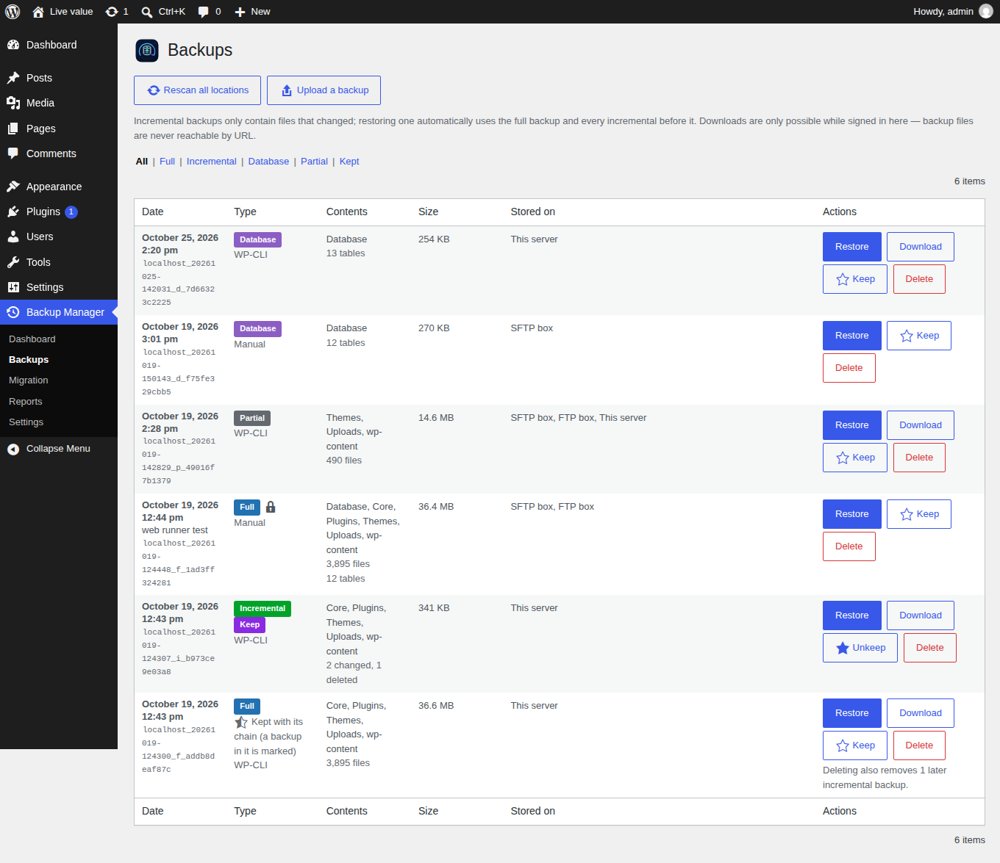
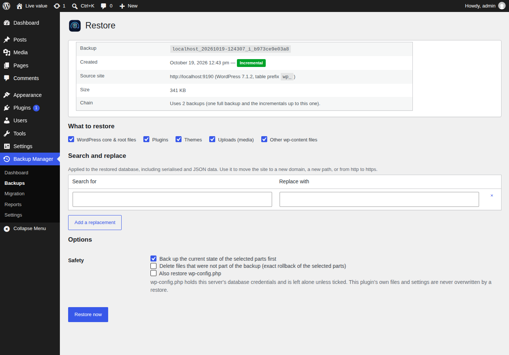
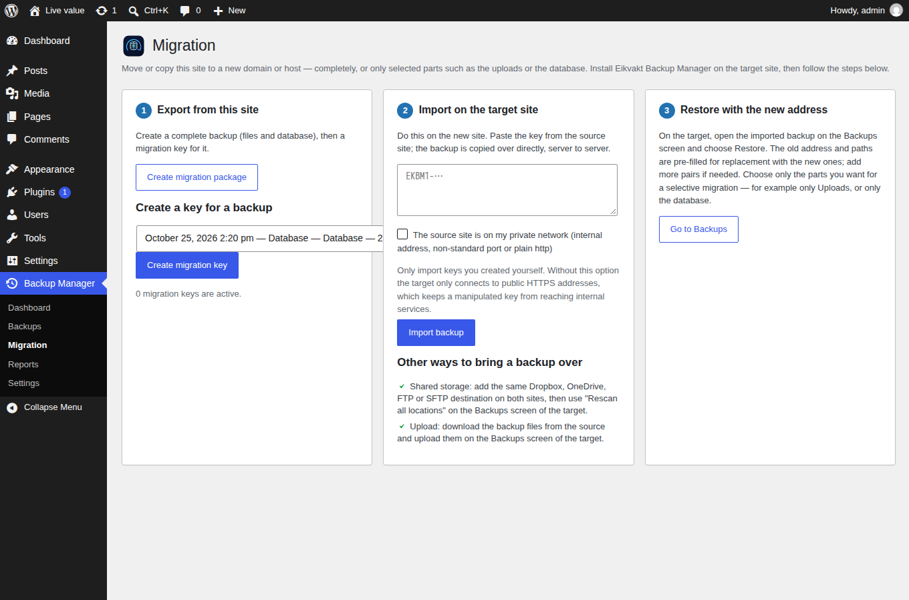
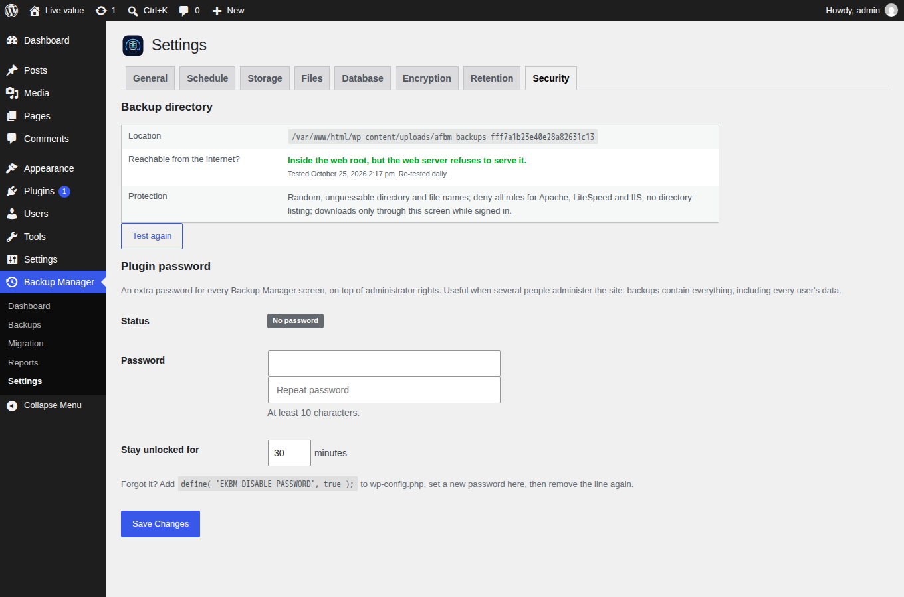

# Eikvakt Backup Manager

Backups, restores and migrations for the whole WordPress installation:
incremental file backups, selectable database tables, encryption, scheduling,
retention rules per location, and simultaneous upload to this server, FTP/FTPS,
SFTP, Dropbox and OneDrive. Restore files, database, plugins or themes
separately, or move the site to a new domain or host.

**There is no PRO version. Every feature is free, and will stay that way.**

**About the name:** *Eikvakt* (say "ayk-vahkt") joins two Norwegian words:
*eik*, oak, and *vakt*, watch or guard — the oak guard. Oak for what lasts, a
guard for what keeps watch. Which is fairly close to the entire job
description: watch over a good copy of the site, and give it back the moment
it is needed. Like its sibling plugin *Vokull Security Center*, it carries a
Nordic name.

This README is the developer manual's front page. The detailed documentation
lives in [`docs/`](docs/README.md); the user-facing description is in
[`readme.txt`](readme.txt).

## Screens

<table>
<tr>
<td width="50%"><a href="screenshots/en/01-dashboard.png"></a><p><b>Dashboard</b> &mdash; one-click setup, status tiles, backup now, live progress.</p></td>
<td width="50%"><a href="screenshots/en/02-backups.png"></a><p><b>Backups</b> &mdash; full, incremental, database and partial sets, where each is stored.</p></td>
</tr>
<tr>
<td><a href="screenshots/en/03-restore.png"></a><p><b>Restore</b> &mdash; choose parts and tables, search &amp; replace, safety backup.</p></td>
<td><a href="screenshots/en/04-migration.png"></a><p><b>Migration</b> &mdash; migration keys, server-to-server import.</p></td>
</tr>
<tr>
<td><a href="screenshots/en/06-report-detail.png"></a><p><b>Report</b> &mdash; what ran, what was included, where it went, full log.</p></td>
<td><a href="screenshots/en/07-settings-storage.png"></a><p><b>Storage</b> &mdash; destinations with per-destination retention.</p></td>
</tr>
<tr>
<td><a href="screenshots/en/10-settings-retention.png"></a><p><b>Retention</b> &mdash; counts, GFS rotation, days on this server and remote.</p></td>
<td><a href="screenshots/en/11-settings-security.png"></a><p><b>Security</b> &mdash; backup directory self-test, plugin password.</p></td>
</tr>
</table>

All screens exist in English and German: [`screenshots/en`](screenshots/en),
[`screenshots/de`](screenshots/de). They are generated, not hand-made — see
[Screenshots](#screenshots-and-icons).

## Design principles

* **Never lose a backup to a timeout.** Every job runs in resumable steps of a
  few seconds, driven by loopback requests, WP-Cron *and* the admin screen.
  Shared hosting is the baseline, not an edge case.
* **Backups are never reachable by URL.** Outside the web root where possible,
  otherwise locked down and probed over HTTP daily. Downloads only through the
  authenticated admin.
* **A failed restore changes nothing.** The database is imported into
  temporary tables and swapped in atomically at the end; files are written to a
  temporary name and renamed into place.
* **One unavailable destination never costs the backup.** Destinations are
  independent; failures are retried, then reported.
* **No relay server, no account, no telemetry.** OAuth apps belong to the site
  owner; nothing leaves the site unless a destination was configured.
* **WordPress.org rules apply.** GPL, no locked features, no bundled
  translations, Plugin Check clean, every external service documented.

## Features at a glance

| Area | What it does | Docs |
|---|---|---|
| Backup | Whole installation (core, plugins, themes, uploads, rest of wp-content) plus database | [backup format](docs/backup-format.md) |
| Incremental | Full + incremental chains; only changed files after the first backup | [backup format](docs/backup-format.md#chains) |
| Files | Clickable folder tree: include/exclude any folder, most specific rule wins; patterns, size limit | [architecture](docs/architecture.md#backup-phases) |
| Database | Pure-PHP resumable dump, all or selected tables | [architecture](docs/architecture.md) |
| Destinations | This server, FTP/FTPS, SFTP, Dropbox, OneDrive — simultaneously | [storage drivers](docs/storage-drivers.md) |
| Scheduling | Files and database separately: every N hours, daily, weekly, monthly | [architecture](docs/architecture.md#scheduling) |
| Before updates | Backup of what changes before core/plugin/theme updates | [architecture](docs/architecture.md#backups-before-updates) |
| Retention | Counts, GFS, max age, days per location, per-destination override; "Keep" marks exempt chosen backups | [architecture](docs/architecture.md#retention) |
| Restore | Per component and per table, search & replace, safety backup | [restore and migration](docs/restore-and-migration.md) |
| Migration | Migration keys, shared storage or upload; URL/path/prefix rewriting | [restore and migration](docs/restore-and-migration.md#migration) |
| Encryption | XChaCha20-Poly1305 stream format, PBKDF2 key | [backup format](docs/backup-format.md#encryption) |
| Security | Exposure self-test, authenticated downloads, sealed credentials, plugin password | [security](docs/security.md) |
| Reports | Run history with full logs, e-mail reports | [architecture](docs/architecture.md#reports) |
| WP-CLI | `wp eikvakt backup|restore|list|keep|migrate|prune|rescan|status` | [WP-CLI](docs/wp-cli.md) |

## Requirements

* WordPress 6.5+, PHP 8.1+
* PHP `zip` extension (ZipArchive) for file backups
* PHP cURL for the FTP/FTPS destination
* libsodium (bundled with PHP; WordPress ships `sodium_compat` as fallback) for encryption

## Installation

From the release ZIP: Plugins → Add New → Upload. From source: see
[Local development](#local-development) — `vendor/` is not tracked and must be
installed with Composer.

## Configuration constants

| Constant | Effect |
|---|---|
| `EKBM_DISABLE_PASSWORD` | `true` bypasses the plugin password (recovery when it is lost). |
| `EKBM_DROPBOX_APP_KEY` | App key of the built-in Dropbox app, overriding `Storage_Dropbox::PLUGIN_APP_KEY`. |

Everything else is a setting in the admin, or a [filter](docs/hooks.md).

## Local development

Everything runs in Docker; nothing but Docker is needed on the host.

```sh
cp docker-compose.yml-example docker-compose.yml
cp .env.example .env
docker compose up -d --build

docker compose exec wpcli wp core install --url=http://localhost:9190 --title="Eikvakt Dev" \
  --admin_user=admin --admin_password=admin123 --admin_email=admin@example.test --skip-email
docker compose exec wpcli wp plugin activate eikvakt-backup-manager

# Second site, the migration target (table prefix wpt_):
docker compose exec wpcli-target wp core install --url=http://localhost:9192 --title="Eikvakt Target" \
  --admin_user=admin --admin_password=admin123 --admin_email=admin@example.test --skip-email
docker compose exec wpcli-target wp plugin activate eikvakt-backup-manager

# Dependencies (no local PHP needed):
docker run --rm -u "$(id -u):$(id -g)" -v "$PWD":/app -e COMPOSER_HOME=/tmp/composer composer:2 install
```

| URL / host | What |
|---|---|
| http://localhost:9190 | Source site (admin / admin123) |
| http://localhost:9192 | Migration target |
| http://localhost:9191 | phpMyAdmin |
| http://localhost:9125 | Mailpit (report e-mails) |
| `ftp:21`, `sftp:22` | Storage test servers (user `backup` / `backup-secret`, SFTP folder `upload/…`) |

Details, including the three dev-only must-use plugins, are in
[docs/development.md](docs/development.md).

## Tests and linting

```sh
docker run --rm -v "$PWD":/app -w /app php:8.3-cli-alpine php vendor/bin/phpunit --testdox
docker run --rm -v "$PWD":/app -w /app php:8.3-cli-alpine php -d memory_limit=1G vendor/bin/phpcs
dev/screenshots/run.sh smoke          # browser smoke test against the Docker site
```

What is covered where, and the manual end-to-end checklist: [docs/testing.md](docs/testing.md).

## Screenshots and icons

```sh
dev/screenshots/run.sh          # icons, banners, all screens in English and German
dev/screenshots/run.sh icons    # icons and banners only
```

Runs the official Playwright image against the Docker site. The SVG master is
`assets/logos/eikvakt-backup-manager-icon.svg`; PNGs and the WordPress.org
banners are rendered from it.

## Coding conventions

Same as the sibling plugin *Vokull Security Center*:

* Namespace `EikvaktBackupManager`; `final class Under_Score` in `class-kebab-case.php`.
* Prefixes: `EKBM_` (constants), `ekbm_` (options, hooks, tables, form fields).
* No autoloader in production: the main file `require_once`s every class in
  dependency order. Composer's autoloader is loaded lazily for phpseclib only.
* Components are objects with a `register(): void` method that only adds hooks.
* WordPress Coding Standards (`phpcs.xml.dist`), short arrays, tabs, Yoda conditions.
* Every deviation is an inline `phpcs:ignore` with the reason, so Plugin Check
  honours it too.
* Comments explain *why*.
* Logic that can be free of WordPress is (Components, Manifest, File_Index,
  Encryptor, Search_Replace, Schedule, Retention_Policy, Sql_Importer) — and is
  unit-tested.

## Releasing (maintainer)

1. Bump the version in **three** places: plugin header, `EKBM_VERSION`,
   `Stable tag` in readme.txt. Add a CHANGELOG.md entry and mirror it into
   readme.txt.
2. `./package-plugin.sh` builds `dist/eikvakt-backup-manager-<version>.zip`
   (allow-list staging, `composer install --no-dev`, refuses dev files).
3. Push to `main`: `.github/workflows/auto-tag.yml` tags, builds the same ZIP
   and publishes a GitHub release; `deploy-to-wordpress-org.yml` syncs it to SVN.

More in [docs/releasing.md](docs/releasing.md).

## Translations

English source strings, text domain `eikvakt-backup-manager`. No translation
files ship in the ZIP — WordPress.org delivers them from translate.wordpress.org.
The template is `languages/eikvakt-backup-manager.pot`; the German translation to
import there is `dev/translations/eikvakt-backup-manager-de_DE.po`. See
[docs/translations.md](docs/translations.md).

## Privacy

The author collects nothing; the plugin runs on the site owner's server and
sends backups only to destinations the owner configures. Full text:
[PRIVACY.md](PRIVACY.md).

## Licence

GPL-2.0-or-later. See [LICENSE.txt](LICENSE.txt).
