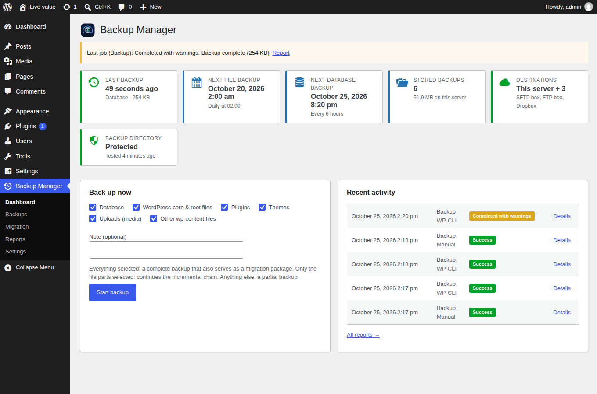
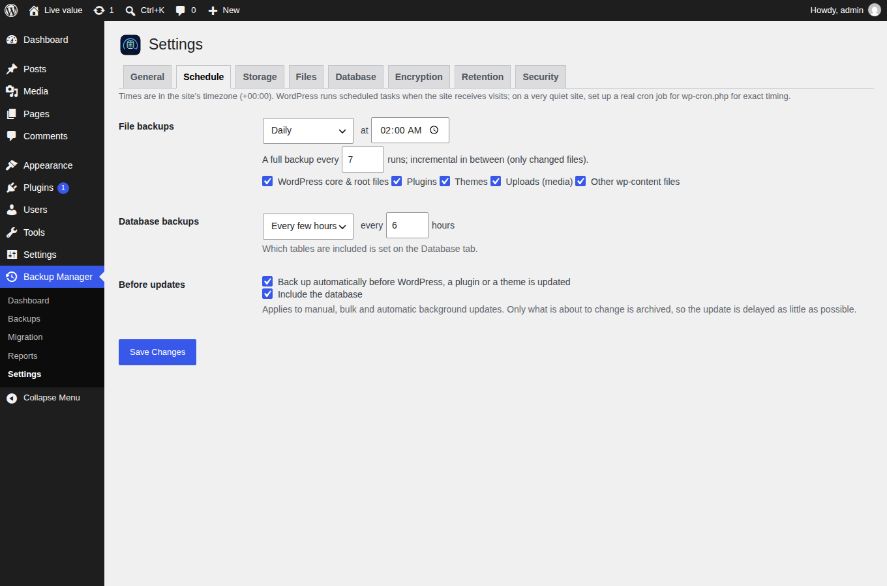
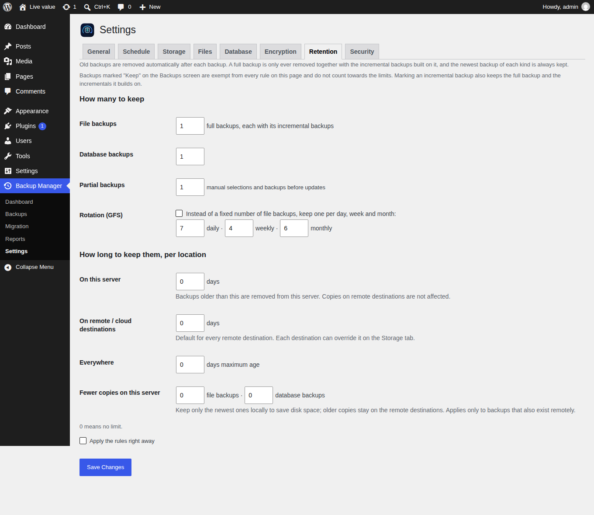
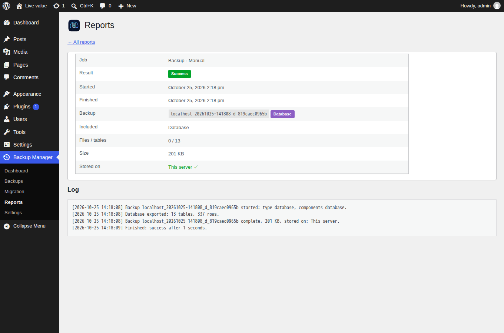

# Architecture



## Layout

```
eikvakt-backup-manager.php     bootstrap: constants, platform guards, require_once list, hooks
uninstall.php                deletes data only when the admin opted in
includes/
  class-plugin.php           singleton; boot() creates components, each register()s hooks
  class-installer.php        options, table, cron hooks, activate/deactivate/migrate/uninstall
  class-settings.php         defaults and typed access, one array option per area
  class-paths.php            backup directory choice, deny files, HTTP exposure self-test
  class-secret-cipher.php    AES-256-GCM sealing of stored credentials (key from salts)
  class-util.php             tokens, safe delete, formatting, stream copy
  engine/                    Job_Runner, Job_Store, Transfer, Job_Handler interface
  backup/                    Components, Manifest, Catalog, File_Index, File_Scanner, Archiver, Database_Dumper, Backup_Job
  restore/                   Restore_Job, Sql_Importer, Search_Replace
  migration/                 Migration (keys + pull endpoint), Pull_Job
  storage/                   Storage_Driver interface, Local, Ftp, Sftp, Dropbox, Onedrive, OAuth, Destinations
  schedule/                  Schedule (pure), Scheduler (cron), Pre_Update_Backup
  retention/                 Retention_Policy (pure), Retention (applies it)
  report/                    Run_Repository (ekbm_runs table), Email_Report
  access/                    Password_Gate
  setup/                     Setup (one-click defaults)
  cli/                       Cli_Command (`wp eikvakt`)
admin/
  class-admin.php            menu, assets, notices, POST dispatch, authenticated download
  class-admin-actions.php    one handler per form; all sanitising happens here
  class-ajax.php             progress polling (drives jobs) and chunked upload
  class-*-list-table.php     Backups and Reports lists (WP_List_Table)
  views/                     one template per screen, settings/tab-*.php per tab
assets/                      admin.css, admin.js (plain ES5, no build), logos
```

No autoloader at runtime: the bootstrap requires every class in dependency
order. Composer's autoloader is loaded only by the SFTP driver (phpseclib).

## Where data lives

| Data | Storage | Why there |
|---|---|---|
| Settings | `wp_options`: `ekbm_settings`, `ekbm_schedule`, `ekbm_retention`, `ekbm_database`, `ekbm_encryption`, `ekbm_security`, `ekbm_destinations` | Standard; one option per area so tabs never overwrite each other |
| Credentials | inside `ekbm_destinations` / `ekbm_encryption`, sealed by `Secret_Cipher` | A database dump alone does not reveal them |
| Run history | table `{prefix}ekbm_runs` | Queryable; **excluded** from backups and restores so history survives a rollback |
| Backup catalog | `catalog.json` in the backup directory, including "keep" marks | Must not roll back with the database; rebuilt from manifests on "Rescan" |
| Running job, queue | `.work/current.json`, `.work/queue.json` | A restore replaces the database while it runs |
| Backup sets | backup directory and destinations | See [backup format](backup-format.md) |

During a database restore the current `ekbm_*` options are copied into the
restored options table before the swap, so the plugin keeps *this* site's
settings (backup directory, storage key, credentials) — essential after a
migration.

## Request flow of a backup

1. A trigger enqueues a job: dashboard button, schedule (cron), WP-CLI
   (`run_now`, synchronous), or the update hook (`run_now`, synchronous).
2. `Job_Runner::kick()` schedules a WP-Cron fallback and fires a non-blocking
   loopback to `admin-ajax.php?action=ekbm_tick`.
3. Each tick takes the flock, runs the handler's `step()` until the time budget
   (default 20 s) is used, saves state, kicks again.
4. The dashboard polls `ekbm_status`, which also runs a short tick when no other
   process holds the lock.
5. On completion the run row is finalised, the e-mail report is sent if
   configured, and `ekbm_job_finished` fires.

Details: [job engine](job-engine.md).

## Backup phases

`scan → diff → archive → database → encrypt → upload → finalize → retention`

* **scan** walks `root/` (ABSPATH, minus wp-content) and `content/`
  (WP_CONTENT_DIR) with a persisted directory queue. `File_Rules` decides
  what is included: folder rules from the Files tab (most specific wins,
  applies to the whole subtree; an excluded folder is still entered when a
  folder below it is explicitly included), otherwise the built-in and custom
  patterns; file-name patterns such as `*.log` apply everywhere. The tree on
  the Files tab loads folder names over `wp_ajax_ekbm_tree` (capability,
  nonce, password gate; paths validated, max. 500 entries per folder).
* **diff** compares the scan with the previous index of the chain and writes
  the new index and the list of files to archive.
* **archive** adds files to ZIP parts in batches (≤ 64 MB input per close),
  rotating parts at the configured size; already-compressed formats are stored.
* **database** dumps selected tables with keyset pagination, one statement per
  line, into `.db.sql.gz`.
* **encrypt** seals the dump (and optionally archives and index) chunk by chunk.
* **upload** copies the set to every enabled destination, manifest last.
* **finalize** registers locations in the catalog, drops the local copy if so
  configured, keeps the newest index of the chain in `.work/index-cache/`.
* **retention** applies the rules.

## Scheduling



Two independent schedules, `files` and `database`. A single cron event,
`ekbm_schedule_check`, runs every five minutes and asks `Schedule::next_run()`
(pure, unit-tested) whether a schedule is due. The base time is the latest of
last success, last attempt and the anchor (set when the schedule changes), so a
failed run waits for its next slot instead of retrying every five minutes.

File backups are `type=auto`: `Backup_Job` continues the newest chain when the
component selection matches, the chain is shorter than `full_every`, and the
previous index is in the local index cache — otherwise it starts a new full
backup.

## Backups before updates

`Pre_Update_Backup` hooks `upgrader_pre_download`, which every upgrader
(plugin, theme, core; manual, bulk and background) runs before fetching a
package. It runs a synchronous *partial* backup limited to the affected folder
(`only` parameter) plus the database (shared across a bulk update for 15
minutes). A failure never blocks the update.

## Retention



`Retention_Policy` (pure, unit-tested) decides; `Retention` executes.

* Chains are kept or deleted as a whole; the newest backup of each kind always
  survives.
* **Keep marks.** Sets an administrator marked "Keep" (Backups screen, or
  `wp eikvakt keep <id>`) are removed by `Retention_Policy::unprotected()` before
  any rule runs: they are never deleted automatically and do not count towards
  the limits. Marking any member of a chain protects the whole chain, because
  an incremental needs its full backup and the incrementals before it. A kept
  set — or a set a kept incremental depends on — cannot be deleted by hand
  either until the mark is removed.
* Count-based (`keep_chains`, `keep_database`, `keep_partial`) or GFS rotation.
* Age per location: `local_days`, `remote_days`, and a per-destination override
  (`retention_days` on the destination). Implemented by
  `Retention_Policy::expired_copies()`, which returns *(set, location)* pairs.
* `local_chains` / `local_database` thin out local copies that also exist remotely.
* Only sets whose manifest carries this site's storage key are considered, so
  retention never deletes another site's backups on shared storage.

## Reports



`Run_Repository` writes one row per job: kind, trigger, status
(`success|warning|failed|cancelled`), backup id and type, components, counts,
size, per-destination outcome, summary and the full log (appended after every
step). `Email_Report` sends after a job according to the setting
(always / problems only / never).
