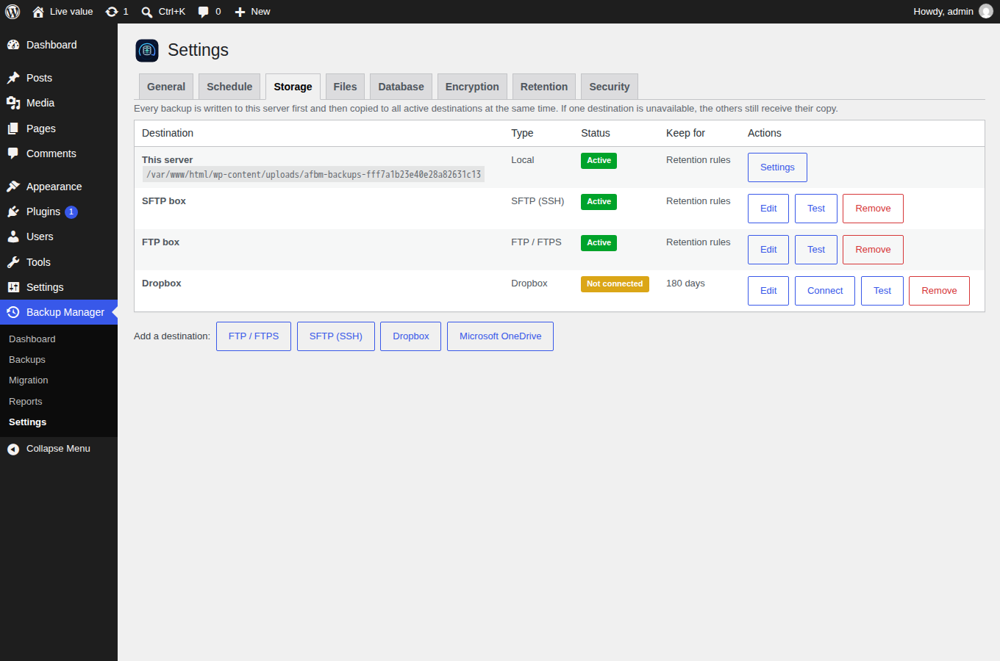
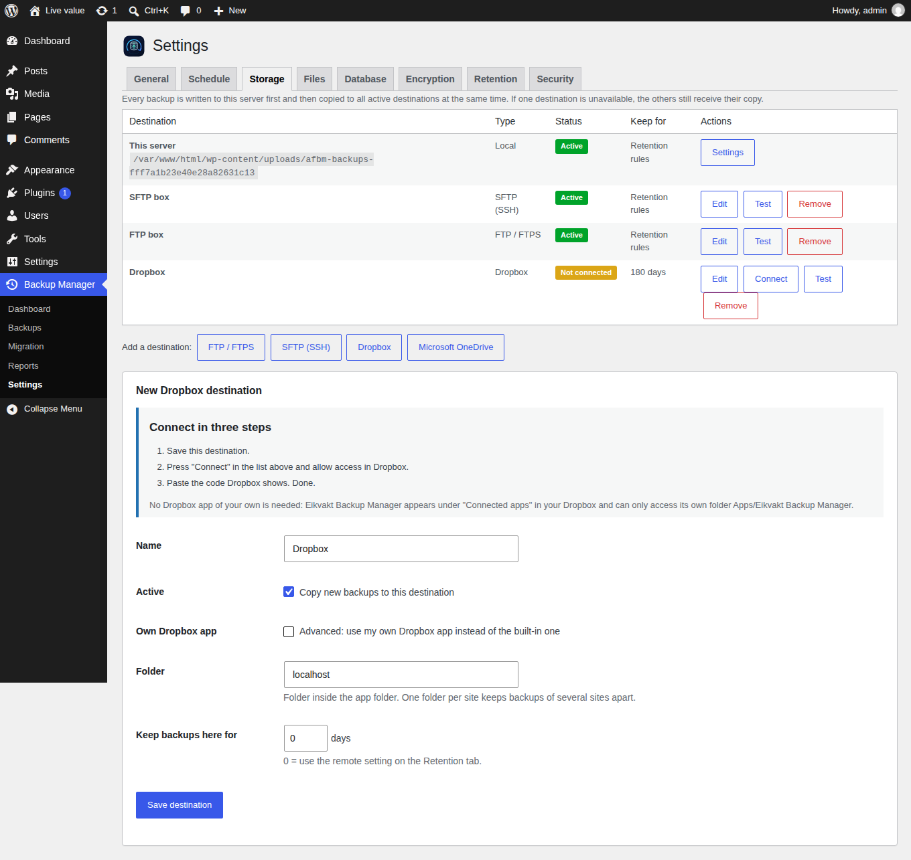

# Storage drivers



## Interface

```php
interface Storage_Driver {
    public function test();                                                    // true|WP_Error
    public function upload( string $local, string $name, array $state, float $deadline ): array;
    public function download( string $name, string $local, array $state, float $deadline ): array;
    public function list_names(): array;
    public function get_contents( string $name ): string;                     // small files (manifests)
    public function delete( string $name ): bool;
}
```

* Flat namespace: each set file is stored under its own name in the
  destination folder. Names are checked with `Util::is_safe_filename()`.
* `upload()`/`download()` are resumable: take the previous `$state`, stop at
  `$deadline`, return the new state with `done => true` when complete.
* Throw `\RuntimeException` with an admin-readable message; `Transfer` retries
  three times, then marks that destination failed and continues with the others.

## Drivers

| Driver | Transport | Resume mechanism | Notes |
|---|---|---|---|
| `Storage_Local` | filesystem | n/a | "This server"; id `local`; always present |
| `Storage_Ftp` | cURL | append 8 MiB chunks from the server-reported size; ranges on download | FTPS = `CURLUSESSL_ALL` + certificate/host verification or public-key pin; relative folder = login dir |
| `Storage_Sftp` | phpseclib 3 | write at offset, 4 MB chunks | password or key; host key pinned on first successful test |
| `Storage_Dropbox` | HTTP API v2 | upload sessions, 8 MB; Range downloads | App-folder app owned by the site admin; PKCE |
| `Storage_Onedrive` | Microsoft Graph | upload sessions, 10 MiB (320 KiB multiple); Range on download URL | `Files.ReadWrite.AppFolder`; rotating refresh tokens saved |

## OAuth (Dropbox, OneDrive)



### Dropbox: built-in app (default) — code paste, no redirect

The plugin ships the **public app key** of its own registered Dropbox app
(`Storage_Dropbox::PLUGIN_APP_KEY`, overridable with the `EKBM_DROPBOX_APP_KEY`
constant or the `ekbm_dropbox_app_key` filter). Users then see
"Eikvakt Backup Manager" under Dropbox → Settings → Apps → Connected apps, like
any other backup app, and never touch the Dropbox developer console.

Dropbox only redirects to pre-registered URLs, and every WordPress site has a
different one. Instead of a relay server, the plugin uses Dropbox's
**no-redirect flow** (as rclone does):

1. *Connect* → `OAuth::begin_paste()` creates a PKCE verifier/challenge and a
   pending entry (sealed verifier, user-bound, 15 minutes) and shows a panel
   with the authorisation URL — without `redirect_uri`.
2. The administrator presses *Allow* in Dropbox; Dropbox displays a one-time
   code.
3. The code is pasted into the panel (`oauth_paste` action, nonce +
   `state` + user binding) and `OAuth::complete()` exchanges it with
   `client_id` + `code_verifier`. No app secret exists in the plugin — PKCE
   replaces it, and a stolen code is useless without the verifier, which never
   leaves the site.
4. Refresh tokens are requested with `token_access_type=offline` and refreshed
   with `client_id` only.

**Registering the built-in app (once, plugin author):**

1. https://www.dropbox.com/developers/apps/create → *Scoped access* →
   *App folder* → name **Eikvakt Backup Manager** (the folder becomes
   `Apps/Eikvakt Backup Manager`).
2. *Permissions*: `files.metadata.read`, `files.metadata.write`,
   `files.content.read`, `files.content.write` → *Submit*.
3. *Settings*: leave *Allow public clients (Implicit Grant & PKCE)* on *Allow*;
   no redirect URI is needed. Add the app icon (`assets/logos/…-1024x1024.png`),
   description and website so the consent screen looks trustworthy.
4. Put the *App key* into `Storage_Dropbox::PLUGIN_APP_KEY`. The app secret is
   **not** used and must not be committed.
5. A new app is in *development* status (up to 500 linked users). Before the
   WordPress.org release, apply for *production* status in the app console.

### Own app (advanced; Dropbox and always for OneDrive)

* No relay server. Each site registers its own app; the Storage tab shows a
  step-by-step guide and the exact redirect URI.
* Redirect URI is `wp-admin/admin-post.php` (no query string — Microsoft rejects
  query strings for personal accounts). `OAuth::callback()` runs on the generic
  `admin_post` action and requires `state`.
* Authorisation-code flow with PKCE (S256). `state` is single-use, bound to the
  user, expires after 15 minutes. The verifier is stored sealed.
* Refresh tokens are sealed in the destination config; access tokens are
  cached (sealed) in a transient until shortly before expiry.

## Destination records

```php
[ 'id' => 'd1a2b3c4', 'type' => 'sftp', 'name' => 'Backup box', 'enabled' => true,
  'retention_days' => 0,           // 0 = Retention tab "remote" default
  'config' => [ 'host' => …, 'password' => 'ekbm1:…sealed…', … ] ]
```

`Destinations::types()` declares fields and which are secret; secret fields are
never echoed back into forms (blank = keep).

## WordPress Playground

Playground runs PHP as WebAssembly. In the browser, its HTTP bridge fails on
any **binary request body** with `Missing header/body separator` (verified:
300 KB of text uploads fine, 64 bytes containing `\0`/`\xff` fail; the same
requests work in the Node.js CLI). There is no ext-ftp and no usable SSH
socket either. Dropbox only accepts raw bytes (or `files/save_url`, which would
need a public URL of the backup — ruled out by design).

`Util::is_playground()` (`post_message_to_js()` exists or `php_uname('s')` is
`Emscripten`) therefore makes the backup job skip remote destinations with one
clear warning, `Destinations::test()` return the explanation, and the Storage
tab show a notice. Backups stay on the site.

## Adding a driver

1. Create `includes/storage/class-storage-<name>.php` implementing `Storage_Driver`.
2. Add it to the `require_once` list in the bootstrap.
3. Declare its fields/secrets in `Destinations::types()` and add it to
   `Destinations::driver()`.
4. Document the external service in `readme.txt` → *External services*.
5. Test: `Destinations::test()`, a backup with a 10 MB part size and a 5 s time
   budget (forces resumed transfers), a restore from that destination only.
